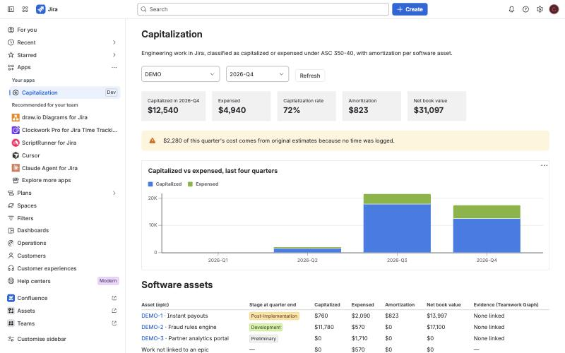
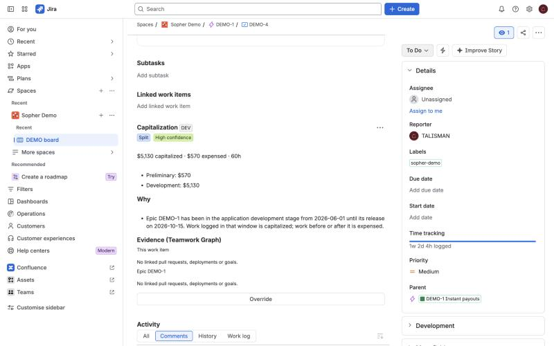
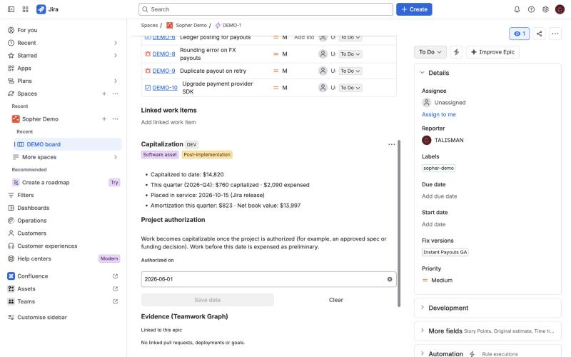
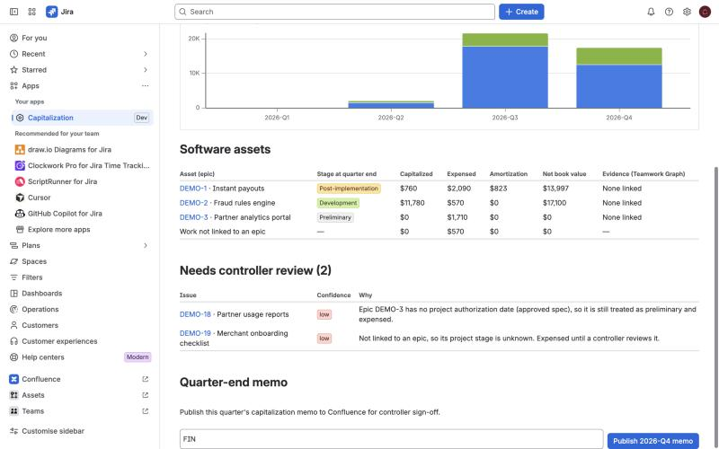
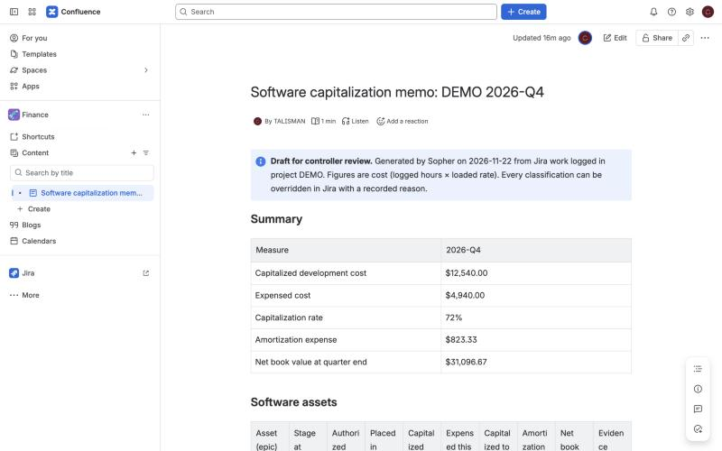
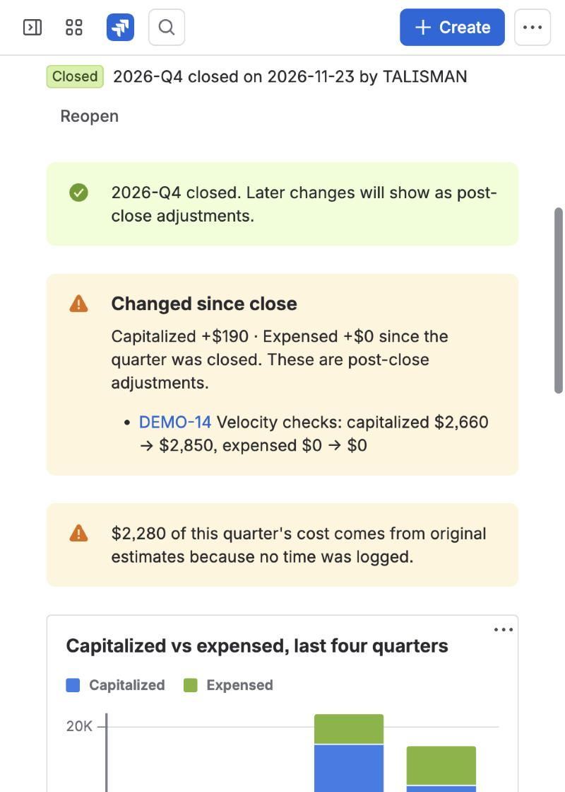
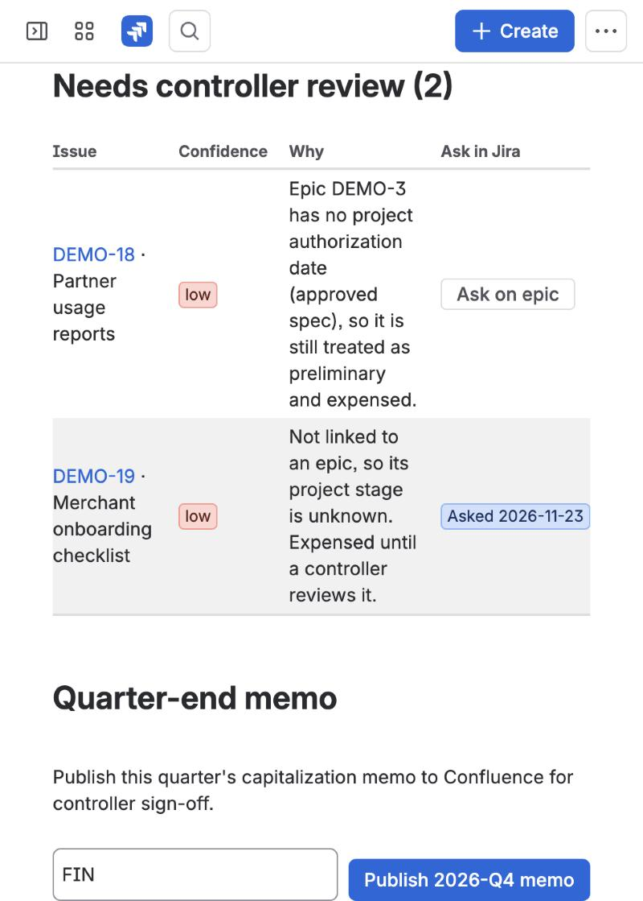

<p align="center"></p>

# Sopher: software capitalization autopilot for Jira

Sopher turns the engineering work already tracked in Jira into an audit-ready **software capitalization schedule**. It follows ASC 350-40 / IAS 38: it classifies every time log as capitalized or expensed, gives a reason for each decision, amortizes each software asset, and publishes the quarter-end memo to Confluence.

Built on Atlassian Forge for **Codegeist 2026**, in the *Apps for Business Teams* category (finance).



## The problem

Software companies must capitalize development-stage work on internal-use software and expense the rest (research, bugs, maintenance, post-release work). Most finance teams estimate the split with quarterly surveys sent to engineers. Sopher uses what Jira already records: what was built, when, by whom and for how long.

## What it does

- **Classification engine.** Each time log is classified by the project stage on its date:
  - preliminary (before authorization): expensed
  - application development: capitalized
  - post-implementation (after release): expensed

  Bugs, maintenance and spikes are always expensed. Unclear items go to a review queue. Every decision comes with reasons.
- **Dashboard** (Apps → Capitalization): capitalized vs. expensed totals, capitalization rate, amortization, net book value, a four-quarter trend, each software asset (epic) with its stage and evidence, and the review queue.
- **Issue panel:** how each issue was treated and why, its Teamwork Graph evidence, and a controller override that requires a reason.
- **Epic = software asset:** the panel on an epic shows its stage, capitalized cost to date, placed-in-service date, amortization and net book value. It also lets you set the **project authorization date** that starts the capitalizable stage.
- **Close the quarter, catch drift:** "Close 2026-Q4" freezes the signed-off figures. After that, any change in Jira (a back-dated time log, an override, an issue moved to another epic) is flagged as a **post-close adjustment** with before and after amounts, on the dashboard, in the memo and in the agent's answers.
- **Ask in Jira:** every review-queue item has a button that posts a targeted question as a Jira comment where it can be fixed, for example "this work isn't linked to an epic, so $570 can't be classified; could you set its parent?" This replaces the quarterly spreadsheet survey.
- **Operating income effect:** how much higher profit is because development cost was capitalized (capitalized minus amortization). This is the number a CFO asks about.
- **Confluence memo:** a one-click quarter-end memo (summary, assets, review items, method, sign-off). Publishing again updates the same page.
- **Teamwork Graph evidence:** pull requests, deployments and goals linked to each epic and issue. An epic with no release in Jira uses its first successful production deployment as its placed-in-service date.
- **Rovo agent "Cap Analyst"** with actions `get-schedule`, `explain-classification`, `list-review-queue` and `draft-cap-memo`. The read actions are also exposed as an **MCP server** (`rovo:mcp`).
- **Agent skill for MCP clients:** [skills/sopher/SKILL.md](skills/sopher/SKILL.md) teaches third-party agents (Claude, Cursor and others) how to use Sopher's MCP tools: connecting, which tool to call, quarter format, and never inventing figures.
- **Demo data loader:** fills an empty project with a sample payments team, so you can try Sopher on an empty site.

| Issue panel | Epic as a software asset |
|---|---|
|  |  |

| Assets and review queue | Confluence memo |
|---|---|
|  |  |

| Changed since close (drift detection) | Ask in Jira |
|---|---|
|  |  |

## Try it

1. Install Sopher on your Jira site from the installation link on the Devpost page. Add it to Confluence too if you want memos.
2. Create an empty company-managed Scrum project, for example key `DEMO`, and make sure time tracking is on.
3. Go to **Jira settings → Apps → Sopher settings → Demo data**, enter `DEMO`, and click **Load demo data**.
4. Open **Apps → Capitalization** and choose **2026-Q3** or **2026-Q4**.
5. Open **DEMO-4** for a split classification, or **DEMO-3** to set a project authorization date and watch the numbers move.
6. Click **Close 2026-Q4**, then change something (log time on DEMO-14 dated in November, or override an issue) and click **Refresh**. The change appears under "Changed since close".
7. In **Needs controller review**, click **Ask on issue** for DEMO-19. A comment appears on the issue.
8. **MCP (optional):** in **admin.atlassian.com → your site → Connected apps → Sopher → View app details**, click **Enable tools** under **Tools** for each Sopher install, Jira and Confluence (it's off by default). Then connect an MCP client, for example `claude mcp add --transport http sopher https://mcp.atlassian.com/forge/531f3777-ac41-4ef3-8c9c-5ba9aa764708`, and ask "What did we capitalize in DEMO for 2026-Q4?".

## Develop

```bash
npm install
npm test            # 37 tests: engine, demo data, memo, seeder, evidence, close, nudges, personal data, logging
forge deploy -e development
forge install --site <your-site>.atlassian.net --product jira -e development
```

The code is laid out as follows:
- `src/engine/`: pure classification, schedule, dates, memo, evidence, quarter-close, nudge and personal-data logic, with no Forge calls
- `src/data/`: Jira, Confluence, Teamwork Graph and Forge storage access, plus the demo seeder
- `src/index.js`: UI resolvers, Rovo actions and the daily personal-data job
- `src/frontend/`: UI Kit pages

## Privacy and support

See [PRIVACY.md](PRIVACY.md). Every day, Sopher checks the account IDs in its override audit trail with Atlassian and anonymizes any closed accounts. For questions and issues, use [GitHub Issues](https://github.com/ArhaanDev24/sopher/issues).

Sopher is decision support: controllers make the final call and can override any classification.
